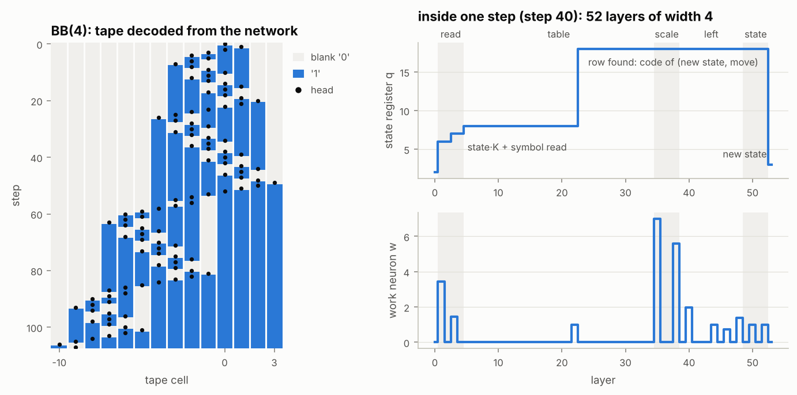

# relu-tm

[](https://github.com/adrianwurm/relu-tm/actions/workflows/ci.yml)

**A fixed width-4 ReLU network that simulates a Turing machine, tested step by step.**

Give `relu-tm` the transition table of a deterministic Turing machine and it
*computes* (no training) the weights of a ReLU network $N:\mathbb R^3\to\mathbb R^3$.
Every hidden layer of $N$ has exactly **four neurons**. $N$ maps the
encoding $(\bar l, \bar r, q)$ of a configuration (left tape, head and right
tape, state) to the encoding of the next configuration.

$N$ is used as a **recurrent network**: its output is fed back as the next
input, $x_{t+1} = N(x_t)$. This is an RNN without external input, whose cell
is a deep feed-forward network of width 4. Unrolled for $t$ steps it becomes
the feed-forward network $N^{[t]}$ of width 4. That is the kind of network
whose verification the NeurIPS 2026 paper studies.

A classical emulator checks the network after **every** step, in exact
rational arithmetic (fractions, or fast dyadic integers) and in
float32/float64.



*Left: the 4-state busy beaver, with its tape decoded from the network's registers after each of
its 107 steps (identical to the emulator). Right: one application of the network. The state register
takes in the head symbol, jumps to the code of the transition that applies, and returns to the new
state. A guided tour is in [notebooks/tour.ipynb](notebooks/tour.ipynb).*

## Install

```bash
pip install torch --index-url https://download.pytorch.org/whl/cpu   # optional: small CPU-only PyTorch
pip install "git+https://github.com/adrianwurm/relu-tm"
# or, from a clone:  pip install -e ".[dev]"
```

## Try it

```console
$ relu-tm run bb2
 step  match  emulator                                  network
    0   ok    A: [0]                                    A: [0]
    1   ok    B: 1 [0]                                  B: 1 [0]
    2   ok    A: [1] 1                                  A: [1] 1
    3   ok    B: [0] 1 1                                B: [0] 1 1
    4   ok    A: [0] 1 1 1                              A: [0] 1 1 1
    5   ok    B: 1 [1] 1 1                              B: 1 [1] 1 1
    6   ok    Z: 1 1 [1] 1                              Z: 1 1 [1] 1

All 6 steps agree (width-4 network, exact).
```

```bash
relu-tm list                                   # example machines
relu-tm run bb4 --every 10                     # busy beaver, 107 steps
relu-tm run 1RB1LB_1LA0LC_1RZ1LD_1RD0RA        # any machine in bbchallenge format
relu-tm run adder -i 101+11                    # binary addition
relu-tm run filler -n 30 -b float32            # watch float32 run out of digits
relu-tm run counter -n 20000 -b dyadic --every 5000   # long exact run with dyadic integers
relu-tm info bb2 --program                     # the network, layer by layer
```

## Your own machine in Python

```python
from relu_tm import TuringMachine, build_network, run

# flips every bit, then halts on the first blank
tm = TuringMachine(
    {("flip", "0"): ("flip", "1", "R"),
     ("flip", "1"): ("flip", "0", "R"),
     ("flip", "_"): ("done", "_", "S")},
    start="flip", blank="_", halt_states={"done"},
)

result = run(tm, "0110")             # emulator vs. network, exact arithmetic
print(result.table())
assert result.agree

net = build_network(tm)              # exact rational weights
print(net.width, net.depth)          # 4, number of hidden layers
module = net.to_torch()              # torch.nn.Module (float64 by default)
```

Finite automata (`DFA`) and deterministic pushdown automata (`DPDA`) share
a small interface with Turing machines. `to_turing_machine()` compiles them
into a TM that the network can run, and the automaton serves as an
independent oracle.

## Import and export

Machines can be read from the files of other tools. They are translated
into `relu-tm`'s own types (`TuringMachine`, `DFA`, `DPDA`), and
`build_network` then works as usual. Export goes the other way.

| format | file | machines | extra software |
|---|---|---|---|
| [bbchallenge](https://bbchallenge.org) text, e.g. `1RB1LB_1LA1RZ` | `.txt` or on the command line | Turing machines (symbols 0–9, L/R) | none |
| [JFLAP](https://www.jflap.org) | `.jff` | Turing machines, finite automata, pushdown automata | none |
| [turingmachine.io](https://turingmachine.io) | `.yaml` | Turing machines (L/R) | PyYAML (`pip install pyyaml`, included in `.[test]`/`.[dev]`) |

```bash
relu-tm run machine.jff -i 0110               # a JFLAP file (DFAs/DPDAs are compiled to a TM first)
relu-tm run palindrome.yaml                   # turingmachine.io: the input stored in the file is used
relu-tm convert bb4 --to turingmachine.io -o bb4.yaml
relu-tm convert machine.jff --to bbchallenge
```

```python
from relu_tm import load, run
mf = load("palindrome.yaml")      # MachineFile(machine, input, format)
print(run(mf.turing_machine(), mf.input).agree)
```

Where the formats differ from this package:

- **JFLAP.** It accepts as soon as a final state is reached, so final states become halting accept states. The wildcards `~` (any symbol, or keep the symbol when writing) and `!a` (any symbol except `a`) are expanded; they range over the symbols that appear in the file. Nondeterminism, multi-tape machines and building blocks are rejected with an error.
- **turingmachine.io.** It has no notion of acceptance, so halting states named `accept`/`accepted`/`yes` become accept states.
- **bbchallenge.** The format has no stay moves and no accept states.

All 15 example machines of turingmachine.io import correctly and run identically on the network.

## How it works (short version)

* **Encoding** (as in Bournez, Cohen & Wurm, MFCS 2025): a tape word becomes a
  base-$\beta$ fraction with odd digits $1,3,5,\dots$ and the blank tail is $0$.
  The encoded values therefore have gaps, and a *continuous* piecewise-linear
  function can read the leading digit. Unlike the paper, the blank also gets
  its own digit, and $0$ is reserved for the infinite blank tail. For
  machines with one non-blank symbol (e.g. busy beavers) the registers are
  $\{1,3\}$-quadradics in base 4.
* **Registers + one work neuron**: three neurons carry `l, r, q` unchanged
  (their values stay $\ge0$), and the fourth evaluates nested ReLU
  expressions. One step of the machine consists of five passes: read the
  head symbol, look up the transition (one "hat" function per case), scale
  the tape registers, move a digit for left moves, restore the state.
* **No training**: all weights are dyadic rationals computed from the
  transition table. The network has $5|\Gamma| + 2|Q|(|\Gamma|+1) + 12$
  hidden layers (BB(4): 52).

The full construction, every inequality it uses, and the deviations from
the paper are in [docs/construction.md](docs/construction.md).

## Notebook

[notebooks/tour.ipynb](notebooks/tour.ipynb) covers:
- your own machine;
- the tape over time;
- the five passes inside one step;
- which row of the transition table fires at each step;
- the numerics plots;
- a short section on how the simulation relates to the complexity of verification (NP / NEXP / RE),
  with a brute-force verifier that runs the network on all 2ⁿ inputs at once.

To run it: `pip install -e ".[notebook]"` and `jupyter lab notebooks/tour.ipynb`. The figures come from `relu_tm.viz`.

## Tests

```bash
pytest                       # ~100 tests, about 10 s
HYPOTHESIS_PROFILE=ci pytest # more random examples, as in CI
```

The central property test generates random machines (up to 4 states and 3
symbols) and random inputs. It checks that after every one of 30 steps the
decoded network registers equal the emulator's configuration. Further tests
cover the busy beavers BB(2)–BB(4), a binary counter, a palindrome
decider, a binary adder, and DFAs/DPDAs compiled to TMs. CI runs on Python
3.10–3.13 for every push.

## Exact versus floating point

With exact rationals the simulation never fails. With the same weights in
floating point ([docs/numerics.md](docs/numerics.md), `relu-tm precision ...`):

* **Base 2^m** (default): all weights are dyadic, so float is *bit-exact* as
  long as every register fits into the mantissa. The limit in digits per
  register is predicted exactly by ⌊(p−1−h)/m⌋, with p = 24 or 53 significand
  bits and 2^h the largest power of two in κ(x+d) during the push:

  | base | float32 | float64 |
  |---|---|---|
  | 4 | 11 | 25 |
  | 8 | 7 | 16–17 |
  | 16 | 5 | 12 |

  Beyond that limit the simulation breaks abruptly. The number of steps does
  not matter. In 692 runs (BB(4), counter, adder, palindrome, 300 random
  machines), no run failed while its registers stayed within ⌊p/m⌋ − 1
  digits.
* **Other bases** (6, 10, 12) round from the first step. If the machine reads
  its tape back, the digit tests of the papers amplify these errors, and the
  simulation fails after a few steps on a tape of only 2–6 cells. With the
  option `build_network(tm, ramps="centre")`, which puts the ramps in the
  middle of the gaps, the network tolerates the rounding and gets about as
  far as in base 2^m.

## Status / roadmap

- [x] emulator (TM, DFA, DPDA), encoding, width-4 construction, exact + float evaluation, tests, CI
- [x] import/export: JFLAP, turingmachine.io, bbchallenge
- [x] numerics step 1: register capacity in float32/float64, role of the base and of the digit tests
- [x] numerics step 2: realistic machines (692 runs). The failure depends only on register length; the gated scaling κ·x rounds first
- [x] notebook: tape and activations over time, numerics plots, relation to verification complexity (NP / NEXP / RE)
- [ ] optional: variants as in MFCS 2025: width 3 ($\bar l{+}q$, $\bar r$, one working neuron) and width 4 via max-min strings ($\bar l{+}q$, $\bar r$, two working neurons)

## Related work

* O. Bournez, J. Cohen, A. Wurm. *A Universal Uniform Approximation Theorem for Neural Networks.*
  MFCS 2025. [doi:10.4230/LIPIcs.MFCS.2025.29](https://doi.org/10.4230/LIPIcs.MFCS.2025.29). Thm 23 is the width-3 TM construction this package follows.
* O. Bournez, J. Cohen, L. Cohen, A. Wurm. *Fractal Gadgets for Neural Networks: The Complexity of the Narrow Regime.*
  NeurIPS 2026, [arXiv:2610.06092](https://arxiv.org/abs/2610.06092), poster page: TODO. Verification of such networks is NP-complete at width 4.
* J. Bates. *A PyTorch Library of Turing-Complete Neural Networks*, 2026,
  [arXiv:2605.08150](https://arxiv.org/abs/2605.08150), [code](https://github.com/jonrbates/turing).
  Implements Siegelmann–Sontag RNNs and a Wei–Chen–Ma transformer in float arithmetic. `relu-tm` differs in using a
  fixed width of 4, exact rational evaluation, and property-based tests against an emulator.
* A. Giannou et al. *Looped Transformers as Programmable Computers.* ICML 2023. [arXiv:2301.13196](https://arxiv.org/abs/2301.13196)
* G. Carmantini et al. *Turing Computation with Recurrent Artificial Neural Networks*, 2015. [arXiv:1511.01427](https://arxiv.org/abs/1511.01427)

## Acknowledgement

Developed with Claude Code as a coding assistant. The construction follows
Bournez, Cohen & Wurm (MFCS 2025) and the gadget discipline of the NeurIPS
2026 paper.

## License

MIT, see [LICENSE](LICENSE).
